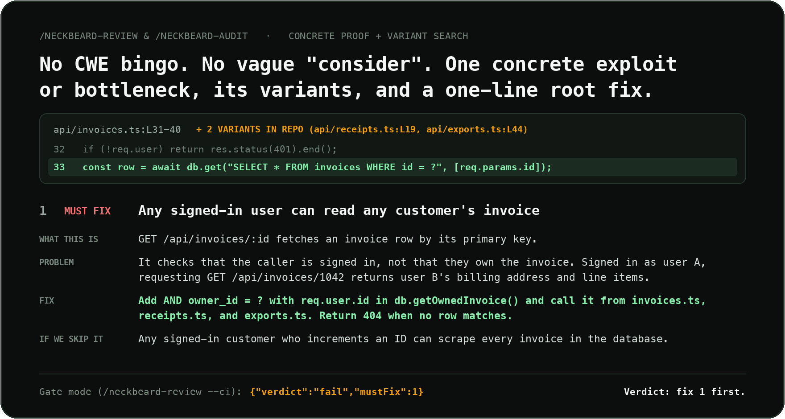
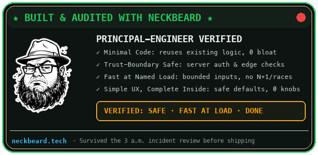

<p align="center">
  <picture>
    <source media="(prefers-color-scheme: dark)" srcset="assets/logo-dark.png">
    
  </picture>
</p>

<h1 align="center">NeckBeard</h1>

<p align="center">
  <em>He tips his fedora once. He deletes your 300-line helper, adds <code>AND owner_id = $1</code>, and goes back to his ThinkPad.</em>
</p>

<p align="center">
  <a href="https://neckbeard.tech"></a>
</p>

<p align="center">
  
  
  
  
  <a href="https://www.itsavibe.ai"></a>
  <a href="LICENSE"></a>
</p>

<p align="center">
  
</p>

<p align="center">
  <strong>Smallest change that is correct, safe at the boundary it crosses, fast and scalable at a named load, simple for the end user, and finished.</strong><br>
  <sub>It comes from <a href="https://github.com/DietrichGebert/ponytail">ponytail</a> and keeps its question ladder, and lean is that ladder rather than a fourth gate.</sub>
</p>

---

You know him. Fedora on the coat rack. ThinkPad X220 with a TrackPoint worn smooth. Has been on the 3 a.m. incident bridge for every *"we'll add object auth in v2"* and *"nobody will ever upload a 50,000-row CSV"* shortcut in the company's history. You hand him a 400-line pull request; he squints through thick frames, mutters *"logged in is not allowed,"* deletes half the diff, absorbs the retry and validation logic inside the boundary so the user never sees a knob, and leaves one hostile-input test behind.

**NeckBeard** puts him inside your AI coding agent.

The full rules and gates live in [`skills/neckbeard/SKILL.md`](skills/neckbeard/SKILL.md) and [`AGENTS.md`](AGENTS.md); both files contain the same rules.

---

## How it works

<p align="center">
  
</p>

Before touching a file, NeckBeard reads the code, its callers, and its tests, asks four framing questions (blast radius, trust boundary, named load as a number, and how to hide necessary complexity from the user), and walks Ponytail's six-rung minimalist ladder.

Then it enforces the three gates from line one:

<p align="center">
  
</p>

> [!IMPORTANT]
> **Simple on the outside, complete on the inside.** A "minimal diff" that pushes flags, multi-step ceremony, or raw stack traces onto the end user is not minimal—it is unfinished. NeckBeard hides necessary complexity inside the module behind safe defaults.

---

## Reviews & Audits with Concrete Proof

<p align="center">
  
</p>

`/neckbeard-review` and `/neckbeard-audit` never play CWE bingo or offer vague *"consider refactoring"* advice. Every finding requires a concrete case (*who sends what and what they get*, *which input breaks what user flow*, or *what concurrency at the named load triggers what bottleneck or race*), automatically searches the repo for all variants of every **Must fix** and **Should fix** flaw, and proposes the smallest root fix that deletes code.

- **No Artificial Finding Cap:** `/neckbeard-audit` (`lite` and `complete`) never caps or hides findings at an arbitrary limit. Every confirmed **Must fix** and **Should fix** issue is reported in full; if a repository has a very large volume of findings (`> 25`), NeckBeard states the exact total found and explicitly alerts/prompts you to expand every remaining item in line-by-line detail or export them into a remediation `SPEC.md` / `.maestro/playbooks/` checklist.
- **Math-Backed Refactor vs. Rewrite-from-Scratch Assessment:** Before ever recommending a rewrite, `/neckbeard-audit` computes and shows the explicit engineering effort/time math comparing **`E_patch`** (`root fixes × affected LOC/callers + hostile-input verification tests`) against **`E_rewrite`** (`clean minimal LOC to pass all 3 gates + caller migration + full test parity × regression risk`). Recommending a full rewrite from scratch is exceedingly rare and only happens when the math proves `E_patch > E_rewrite`.

---

## Skills

| Skill | What it does |
|---|---|
| `neckbeard` | Applies the question ladder and the three gates in [`skills/neckbeard/SKILL.md`](skills/neckbeard/SKILL.md) on coding tasks across `lite`, `full`, `paranoid`, and `off` levels. |
| `neckbeard-review` | Reviews a change against the gates in [`skills/neckbeard/SKILL.md`](skills/neckbeard/SKILL.md) with concrete failure cases, variant search, and `--ci` gate mode. |
| `neckbeard-audit` | Audits a repo or folder (`lite` default: targeted execution flows and major internal/external data & trust boundaries; `complete`: every single code, config, and doc file in the repo, with an upfront time/token/tool-call warning) with zero artificial finding cap, full variant search, and explicit `E_patch` vs. `E_rewrite` effort/time math. |
| `neckbeard-debt` | Scans tracked and untracked files for `risk:`, `shortcut:`, and `ponytail:` markers and enforces the accepted-risk boundary from [`skills/neckbeard/SKILL.md`](skills/neckbeard/SKILL.md). |
| `neckbeard-gain` | Local telemetry report and 5-tab Security & Engineering Command Center (`~/.config/neckbeard/telemetry/dashboard.html`): 14-day API cost & prompt-cache velocity chart, clickable per-repository scorecard, per-model cache economics, External→Internal Trust-Boundary Graph, searchable session forensics, and front-and-center 5-pillar `.ai-audit/` VIBES provenance & PRISM risk intelligence. |

---

## Project Load Default, Trust-Boundary Map & Sharing (`.neckbeard.json`)

When you don't specify load parameters in a prompt, NeckBeard checks `.neckbeard.json` (and repo docs). If no load target exists and the **Fast** gate applies, NeckBeard asks one concise question to ascertain load, saves it as the project default, and reuses it automatically moving forward.

For **trust boundaries**, NeckBeard never asks you to do its threat modeling: it derives the boundary itself from the ask, the code, and a **concise internal & external trust-boundary map** (`<= 600` chars / `~150` tokens) injected at `SessionStart` and `SubagentStart`:
- **External boundaries (`[ext]`):** `ingress` (`http-in`, `cli-in`, `webhook-in`), `egress` (`http-out`), and `supply` (`ci`).
- **Internal boundaries (`[int]`):** `auth` (`auth`), `data` (`sql`, `fs`, `serde`), `exec` (`proc`, `crypto`, `env`), and `ai` (`ai`).
- When an architectural detail is ambiguous, NeckBeard defaults to **siding toward a fail-closed conclusion** rather than pausing to ask.

### What Sharing Means (Enabled by Default) & How to Toggle It

- **Shared by default (`/neckbeard share on`):** NeckBeard writes `.neckbeard.json` at the repository root with `"shared": true`. **Sharing means committing `.neckbeard.json` to Git** so teammates, subagents, git worktrees, and CI review runs (`/neckbeard-review --ci`) immediately use the exact same load target and trust-boundary map without cold-start discovery tokens.
- **Strict automatic censorship:** Both [`hooks/surface.js`](hooks/surface.js) and [`hooks/guard.js`](hooks/guard.js) strictly censor `.neckbeard.json`. Boundary entries are restricted to `<repo-relative-posix-path>-><closed-sink-enum>`; any URLs, internal hostnames, IP addresses, emails, absolute local paths, or secrets are stripped on save and blocked by the `PreToolUse` guard.
- **Disable sharing (`/neckbeard share off`):** Moves the project's load target and boundary map out of the repository into `~/.config/neckbeard/projects/<repo>.json`, removes `.neckbeard.json` from the working tree (and untracks it via `git rm --cached`), and adds `.neckbeard.json` to `.git/info/exclude` so it is never committed.
- **Re-enable sharing (`/neckbeard share on`):** Writes the sanitized `.neckbeard.json` back to the repository root and removes it from `.git/info/exclude` so it can be committed to Git.
- **Commands:**
  - `/neckbeard load 200 rps, 50k rows, p95 < 100ms` — Set or update the project's default load target.
  - `/neckbeard load webhook-in=2000 rps burst` — Set a per-boundary load envelope (`boundaryLoad`) for a specific sink or boundary group (`http-in`, `cli-in`, `webhook-in`, `http-out`, `ci`, `auth`, `sql`, `fs`, `proc`, `serde`, `crypto`, `env`, `ai`, `ingress`, `egress`, `supply`, `data`, `exec`).
  - `/neckbeard map` — Scan or refresh the concise internal and external trust-boundary map.
  - `/neckbeard share on` / `/neckbeard share off` — Enable or disable Git sharing of `.neckbeard.json`.
- **Automatic Boundary-Expansion Drift Alerts & Debt Expiry Triggers:**
  - When a code change adds a new external or internal boundary sink not present in `.neckbeard.json`, NeckBeard flags the unreviewed boundary expansion (`⚠ +N boundary`) in prompt context, in the Claude Code and Pi status bars, and in [`/neckbeard-review`](skills/neckbeard-review/SKILL.md).
  - [`/neckbeard-debt`](skills/neckbeard-debt/SKILL.md) compares `risk:` comment revisit thresholds against the load in `.neckbeard.json` and flags any deferral whose trigger has already been crossed as `expired-load-trigger` under **Must fix now**.

---

## Claude Code Banner (`AbovePrompt` HUD) & Security Command Center

In Claude Code (CLI and Desktop), NeckBeard loads [`hooks/claude-band.json`](hooks/claude-band.json) ([`hooks/band/register.tsx`](hooks/band/register.tsx)) to render an interactive HUD above the prompt input box and maintain a **100% local** JSONL telemetry store (`~/.config/neckbeard/telemetry/sessions.jsonl`) and self-contained 5-tab **NeckBeard Security & Engineering Command Center** (`~/.config/neckbeard/telemetry/dashboard.html`):

- **High-Value Baseline Engineering Intelligence (Even Without VIBES):**
  - **4-Card 3-Gate & Economics Scoreboard:** Code Minimalism & Reuse (`+inserted / -deleted LOC`, symbol reuse %), `PreToolUse` Shield & Safety (`N blocked`), Token Cache & Cost Efficiency (`$` spend, total tokens, `% prompt cache hit rate`), and Active Engineering Velocity (`hours/minutes`, `.neckbeard.json` target load).
  - **14-Day Cost, Session & Cache Velocity SVG Chart + Repo & Model Economics Tables:** Visualizes daily API spend and prompt-cache efficiency, ranks every local repository in a clickable scorecard, and breaks down token/cache/cost efficiency per model (`Opus`, `Sonnet`, `Haiku`).
  - **Interactive External `[ext]` → Internal `[int]` Trust-Boundary Graph & Searchable Session Forensics:** Maps saved `.neckbeard.json` boundaries and highlights unreviewed boundary-expansion drift (`⚠ +N boundary`).
- **Exponential 5-Pillar Deep Forensics When VIBES (`.ai-audit/`) Is Enabled:**
  - When `.ai-audit/` ([VIBES Protocol](https://www.itsavibe.ai)) is present in a workspace, [`hooks/vibes.js`](hooks/vibes.js) and [`hooks/band-import.js`](hooks/band-import.js) unlock the **5-Pillar VIBES Hub** (`VIBES v1.1` content-addressed `manifest.entries` hash resolution & `line_start`/`line_end` file attribution, `VERIFY v1.0` DSSE & high-assurance attestation coverage, `PRISM v1.0` 3-panel SVG risk histogram + turn-by-turn risk trajectory sparkline + file hotspots, `EVOLVE v1.0` architectural decisions & reasoning chains, `TRACE v1.0` incident/IoC forensics, and a turn-level `.ai-audit/annotations.jsonl` provenance inspector).
  - When `.ai-audit/` is not yet initialized in a selected workspace, the Command Center provides a one-click **"Preview Full VIBES (.ai-audit/) Forensics"** interactive demo and quickstart onboarding (`npx vibecheck init && vibecheck validate`).
- **HUD commands:** `/neckbeard band [on|off|import|board]` or `/neckbeard-gain`.

---

## Hosts

| Host | What it loads |
|---|---|
| **Claude Code** | Full plugin: loads the five skills, [`hooks/claude-hooks.json`](hooks/claude-hooks.json) (session & subagent rule/map injection, `/neckbeard` level/load/map/share/band commands, and the `PreToolUse` secret, VIBES, and config-censor guard), and [`hooks/claude-band.json`](hooks/claude-band.json) (`AbovePrompt` telemetry banner & local HTML board). |
| **Codex** | Full plugin: loads [`.codex-plugin/plugin.json`](.codex-plugin/plugin.json), the five skills (`$neckbeard`, `$neckbeard-review`, `$neckbeard-audit`, `$neckbeard-debt`, `$neckbeard-gain`), and [`hooks/claude-hooks.json`](hooks/claude-hooks.json) for session activation and `$neckbeard` commands. |
| **GitHub Copilot CLI** | Loads [`.github/plugin/plugin.json`](.github/plugin/plugin.json) (the five skills) and [`AGENTS.md`](AGENTS.md) / [`.github/copilot-instructions.md`](.github/copilot-instructions.md). |
| **Copilot Editor & Antigravity IDE** | Read [`AGENTS.md`](AGENTS.md) from the open repository root as always-on workspace instructions. |
| **Antigravity CLI & Grok Build** | Load the five skills via [`plugin.json`](plugin.json) and [`.grok-plugin/marketplace.json`](.grok-plugin/marketplace.json) without lifecycle hooks. |
| **Pi (`pi`) & Oh My Pi (`omp`)** | Load [`pi-extension/index.js`](pi-extension/index.js) via `"pi"` in [`package.json`](package.json) for a live TUI status bar (`● 🧔 neckbeard: 🛡️ FULL`), turn-by-turn rule/map injection, and `/neckbeard*` commands. |
| **OpenCode & Kilo Code** | Load [`.opencode/plugins/neckbeard.mjs`](.opencode/plugins/neckbeard.mjs) to inject the ruleset, load target, and trust-boundary map every turn and register the five skills. |
| **Gemini CLI** | Loads [`gemini-extension.json`](gemini-extension.json), setting `contextFileName` to [`AGENTS.md`](AGENTS.md) and discovering `skills/`. |
| **Cursor, Windsurf, and Kiro** | Do not read `AGENTS.md` unless their own rules file (`.cursor/rules/`, `.windsurf/rules/`, `.kiro/steering/`) includes it. |

Full per-host install guide and adapter matrix: **[INSTALL.md](INSTALL.md)** and **[docs/agent-portability.md](docs/agent-portability.md)**.

---

## Install

**One-Command Cross-Platform Auto-Installer & Updater (Windows, macOS, Linux):**

Once you have cloned or downloaded NeckBeard on a system, run one command to automatically detect and install/update **every compatible AI coding agent harness** on your machine (`Claude Code`, `Codex`, `GitHub Copilot CLI`, `Grok CLI`, `Antigravity CLI`, `Gemini CLI`, `Pi / Oh My Pi`, `OpenCode / Kilo Code`) and rebuild your local Command Center:

```bash
node scripts/install-all.js
# or: npm run sync
# preview detected harnesses without changes: node scripts/install-all.js --dry-run
```

**Claude Code:**

```bash
claude plugin marketplace add openasocket/NeckBeard
claude plugin install neckbeard@neckbeard
```

**Codex:**

```bash
codex plugin marketplace add openasocket/NeckBeard
codex plugin add neckbeard@neckbeard
```

**GitHub Copilot CLI:**

```bash
copilot plugin marketplace add openasocket/NeckBeard
copilot plugin install neckbeard@neckbeard
```

**Grok CLI (`grok`):**

```bash
grok plugin install openasocket/NeckBeard --trust
```

Then enable it in Grok (`/plugins` → Plugins → press `Space` on `neckbeard`), or add it to `~/.grok/config.toml`:

```toml
[plugins]
enabled = ["neckbeard"]
```

**Antigravity CLI (`agy`):**

```bash
agy plugin install https://github.com/openasocket/NeckBeard
```

**Gemini CLI:**

```bash
gemini extensions install https://github.com/openasocket/NeckBeard
```

**Any other agent:** Copy `AGENTS.md` into the root of a project whose host does not load this plugin. Cursor, Windsurf, and Kiro do not read `AGENTS.md` unless their own rules file includes it. Full per-host details and configuration: **[INSTALL.md](INSTALL.md)**.

---

## Levels

Switch levels anytime with `/neckbeard`, `$neckbeard`, or `@neckbeard` followed by `lite`, `full`, `paranoid` (or `ultra`), or `off` (or say `"stop neckbeard"`).

| Level | Model behavior | Guard (`PreToolUse`) |
|---|---|---|
| `lite` | Builds what was asked and names the skipped gate or smaller option in one line. | Off |
| `full` (default) | Applies all rules and gates from [`skills/neckbeard/SKILL.md`](skills/neckbeard/SKILL.md) and [`AGENTS.md`](AGENTS.md). | Blocks hardcoded secrets & `.ai-audit/` tampering |
| `paranoid` (alias: `ultra`) | Questions unjustified complexity or attack-surface growth before writing, states the boundary and load number, and refuses to drop trust or data-safety checks. | Blocks hardcoded secrets, `.ai-audit/` tampering & unsafe commands/TLS bypasses |
| `off` | Stops applying the rules. | Off |

Default level: `NECKBEARD_LEVEL` in the environment, else `defaultLevel` in `~/.config/neckbeard/config.json`, else `full`. Levels are stored per session, so parallel agents working in the same repository never overwrite each other's active level.

---

## Guard and lifecycle hooks

Hosts that load [`hooks/claude-hooks.json`](hooks/claude-hooks.json) run four zero-dependency Node.js lifecycle hooks:

| Hook | Script | What it does |
|---|---|---|
| `SessionStart` | [`hooks/session-start.js`](hooks/session-start.js) | Injects the active level's ruleset from [`skills/neckbeard/SKILL.md`](skills/neckbeard/SKILL.md) and preserves the session's level across context compaction. Setting `NECKBEARD_SURFACE=1` opts into the regex attack-surface map ([`hooks/surface.js`](hooks/surface.js), file paths only; default is off). |
| `SubagentStart` | [`hooks/subagent-start.js`](hooks/subagent-start.js) | Passes the active session's ruleset to spawned subagents (`NECKBEARD_SUBAGENTS=0` disables this). |
| `UserPromptSubmit` | [`hooks/prompt.js`](hooks/prompt.js) | Switches the per-session level on `/neckbeard`, `$neckbeard`, or `@neckbeard` (`lite \| full \| paranoid \| off`) and `"stop neckbeard"`. |
| `PreToolUse` | [`hooks/guard.js`](hooks/guard.js) | Inspects file-write and shell tool calls (`Write`, `Edit`, `MultiEdit`, `NotebookEdit`, `Bash`) before execution (`NECKBEARD_GUARD=0` disables this). At `full` and `paranoid`, blocks hardcoded secrets (private keys, AWS, GitHub, Slack, Stripe live, Google, Anthropic, OpenAI, and npm tokens) and blocks direct agent tampering with immutable [VIBES](https://www.itsavibe.ai) `.ai-audit/` provenance and evidence artifacts. At `paranoid`, also blocks `curl … \| sh`, disabled TLS verification, `chmod 777`, `--no-verify`, and literal credential assignments. |

---

## VIBES Protocol Integration ([itsavibe.ai](https://www.itsavibe.ai))

NeckBeard is the **preventive engineering layer**; the **[VIBES Protocol](https://www.itsavibe.ai)** (`VIBES`, `VERIFY`, `PRISM`, `EVOLVE`, `TRACE`) is the **evidentiary provenance and forensics layer**. When a repository has a `.ai-audit/` directory (created by `ClaudeCode-VIBES`, `Codex-VIBES`, `AntigravityCLI-VIBES`, or `VibeCheck`), NeckBeard integrates with it automatically with zero configuration:

| VIBES Specification | How NeckBeard Integrates When `.ai-audit/` Is Present |
|---|---|
| **[VIBES v1.1](https://www.itsavibe.ai/vibes-agent.md) & [VERIFY v1.0](https://www.itsavibe.ai/verify-agent.md)** (Content-Addressed Provenance & DSSE Attestation) | [`hooks/guard.js`](hooks/guard.js) blocks direct agent `Write`/`Edit`/`MultiEdit`/`NotebookEdit` and destructive `Bash` commands targeting immutable provenance and evidence files (`.ai-audit/manifest.json`, `.ai-audit/annotations.jsonl`, `.ai-audit/blobs/`, `.ai-audit/attestations/`, `.ai-audit/incidents/`, `.ai-audit/evidence/`, `.ai-audit/wal/`, `.ai-audit/audit.db`, `.ai-audit/.session_state.json`) so SHA-256 content hashes and Ed25519 DSSE envelopes cannot be corrupted. Operator-editable rules and policy (`.ai-audit/iocs.d/`, `.ai-audit/extensions/`, `.ai-audit/config.json`) and `vibes` / `vibecheck` / `vibetrace` CLI commands pass through normally. |
| **[PRISM v1.0](https://www.itsavibe.ai/prism-agent.md) & [TRACE v1.0](https://www.itsavibe.ai/trace-agent.md)** (Risk Scoring & Incident Forensics) | [`/neckbeard-review`](skills/neckbeard-review/SKILL.md) and [`/neckbeard-audit`](skills/neckbeard-audit/SKILL.md) prioritize changed lines and entry points with High or Critical PRISM `risk_score` (`>= 0.60` in `.ai-audit/annotations.jsonl`), flag any manual tampering with `.ai-audit/` provenance artifacts as **Must fix**, and run `vibecheck validate` or `vibetrace scan` when installed on `PATH`. |
| **[EVOLVE v1.0](https://www.itsavibe.ai/evolve-agent.md)** (Decision Records & Agent Governance) | [`/neckbeard-debt`](skills/neckbeard-debt/SKILL.md) cross-checks `risk:` comments in source code against `decision` records in `.ai-audit/manifest.json` and tags unlinked deferrals with `unrecorded-decision`. |

---

## How it builds on Ponytail

| Dimension | Ponytail | NeckBeard |
|---|---|---|
| **Core philosophy** | Least new code that solves the task | Least new code that is correct, safe at the trust boundary, fast at a named load, and hides complexity from the user |
| **Pre-write framing** | Scope & callers | Scope & callers + **named trust boundary** + **named load as a number** + **hidden complexity boundary** |
| **Question ladder** | 6-rung minimalist ladder | Same 6-rung minimalist ladder (`Lean is this ladder, not a fourth gate`) |
| **Security & object auth** | `"Never cut: validation at trust boundaries..."` | Explicit `Safe` gate (`Authorize the object on the server, every time. Logged in is not allowed.`) + `PreToolUse` secret/command guard |
| **Speed & scale** | Checked during review/audit | Baked into the writing rules (`Fast and scalable at the named number`: input limits, idempotent retries, no N+1, no races, no quadratic or blocking work) |
| **End-user experience** | Minimal implementation of core job | Deep modules: absorb security, retry, and validation complexity inside; safe defaults and actionable failure outcomes outside |
| **Debt ledger** | `shortcut:` comments via `/ponytail-debt` | `risk:` (and `shortcut:`) comments via `/neckbeard-debt`, flagging any `illegal-deferral` of a trust check or data-loss write |
| **Telemetry & Band** | Local CSV ledger, Claude Code band & optional webhook | 100% local JSONL telemetry store (`sessions.jsonl`), Claude Code HUD & NeckBeard Security & Engineering Command Center (`~/.config/neckbeard/telemetry/dashboard.html`) with reuse %, refactor LOC delta, guard blocks, security issues resolved, and automatic `.ai-audit/` VIBES ingestion (zero network calls) |

---

## The NeckBeard Badge & Seal of Survival ([neckbeard.tech](https://neckbeard.tech))

<p align="center">
  <a href="https://neckbeard.tech"></a>
</p>

<p align="center">
  <a href="https://neckbeard.tech"></a>
</p>

> [!IMPORTANT]
> **The NeckBeard Badge Honor Code:** Please only display this badge or seal in your project's `README.md` or documentation if:
> 1. You **built the project with NeckBeard** active (`full` or `paranoid`), **OR**
> 2. You ran **`/neckbeard-audit`** on an existing project and **actually refactored or rewrote** the confirmed **Must fix** and **Should fix** findings.

**Compact README Pill Badge (Markdown):**

```markdown
[](https://neckbeard.tech)
```

**Full "Built & Audited with NeckBeard" Value Seal (Markdown):**

```markdown
[](https://neckbeard.tech)
```

---

## FAQ

**Why does it ask for a load as a number?**
Because *"make it scalable"* without a number produces Kafka clusters for a 20-request-per-minute internal tool, while ignoring load produces N+1 queries and check-then-write races on an endpoint that takes 500 concurrent requests. Naming the number stops both failures.

**Why aren't `risk:` comments allowed on auth or data writes?**
A `risk:` comment may defer a cache or a queue until load crosses a named trigger. Deferring an object-ownership check or a non-atomic write is not technical debt—it is a vulnerability or silent data corruption waiting for its first caller. `/neckbeard-debt` flags those as `illegal-deferral` under **Must fix now**.

**What if I ask for a 5-layer abstract factory in `paranoid` mode?**
He will adjust his glasses, ask why you want five layers for one implementation, state the trust boundary and load number, and build the 12-line version that actually fails closed.

---

## Tests

```bash
npm test
```

No dependencies. Node 18 or later.

## License

[MIT](LICENSE).
