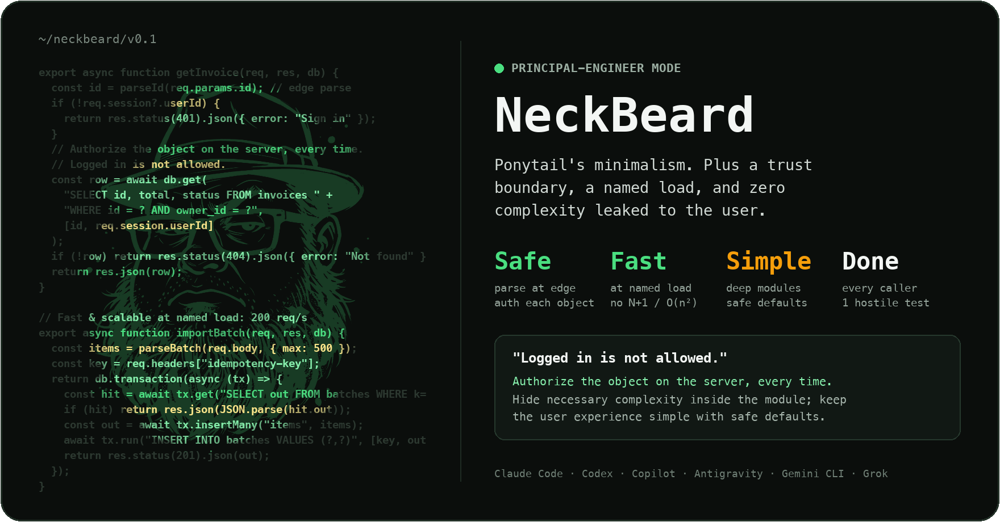
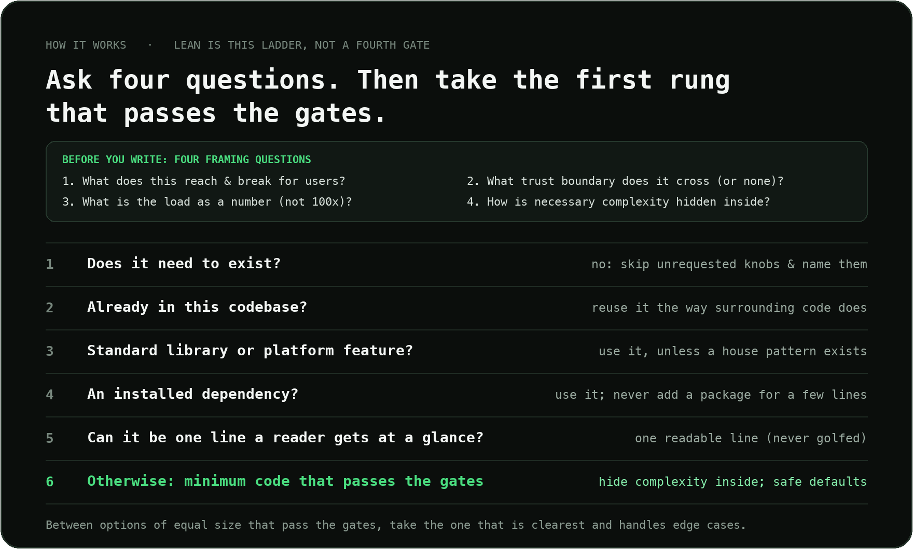
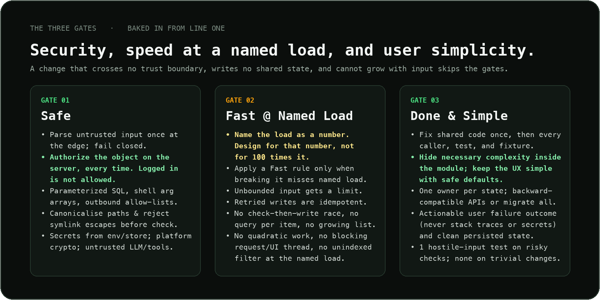

<p align="center">
  <picture>
    <source media="(prefers-color-scheme: dark)" srcset="assets/logo-dark.png">
    
  </picture>
</p>

<h1 align="center">NeckBeard</h1>

<p align="center">
  <em>He tips his fedora once. He deletes your 300-line helper, adds <code>AND owner_id = $1</code>, and goes back to his ThinkPad.</em>
</p>

<p align="center">
  
  
  
  <a href="https://www.itsavibe.ai"></a>
  <a href="LICENSE"></a>
</p>

<p align="center">
  
</p>

<p align="center">
  <strong>Smallest change that is correct, safe at the boundary it crosses, fast and scalable at a named load, simple for the end user, and finished.</strong><br>
  <sub>It comes from <a href="https://github.com/DietrichGebert/ponytail">ponytail</a> and keeps its question ladder, and lean is that ladder rather than a fourth gate.</sub>
</p>

---

You know him. Fedora on the coat rack. ThinkPad X220 with a TrackPoint worn smooth. Has been on the 3 a.m. incident bridge for every *"we'll add object auth in v2"* and *"nobody will ever upload a 50,000-row CSV"* shortcut in the company's history. You hand him a 400-line pull request; he squints through thick frames, mutters *"logged in is not allowed,"* deletes half the diff, absorbs the retry and validation logic inside the boundary so the user never sees a knob, and leaves one hostile-input test behind.

**NeckBeard** puts him inside your AI coding agent.

The full rules and gates live in [`skills/neckbeard/SKILL.md`](skills/neckbeard/SKILL.md) and [`AGENTS.md`](AGENTS.md); both files contain the same rules.

---

## How it works

<p align="center">
  
</p>

Before touching a file, NeckBeard reads the code, its callers, and its tests, asks four framing questions (blast radius, trust boundary, named load as a number, and how to hide necessary complexity from the user), and walks Ponytail's six-rung minimalist ladder.

Then it enforces the three gates from line one:

<p align="center">
  
</p>

> [!IMPORTANT]
> **Simple on the outside, complete on the inside.** A "minimal diff" that pushes flags, multi-step ceremony, or raw stack traces onto the end user is not minimal—it is unfinished. NeckBeard hides necessary complexity inside the module behind safe defaults.

---

## Reviews & Audits with Concrete Proof

<p align="center">
  
</p>

`/neckbeard-review` and `/neckbeard-audit` never play CWE bingo or offer vague *"consider refactoring"* advice. Every finding requires a concrete case (*who sends what and what they get*, *which input breaks what user flow*, or *what concurrency at the named load triggers what bottleneck or race*), automatically searches the repo for variants of every **Must fix** flaw, and proposes the smallest root fix that deletes code.

---

## Skills

| Skill | What it does |
|---|---|
| `neckbeard` | Applies the question ladder and the three gates in [`skills/neckbeard/SKILL.md`](skills/neckbeard/SKILL.md) on coding tasks across `lite`, `full`, `paranoid`, and `off` levels. |
| `neckbeard-review` | Reviews a change against the gates in [`skills/neckbeard/SKILL.md`](skills/neckbeard/SKILL.md) with concrete failure cases, variant search, and `--ci` gate mode. |
| `neckbeard-audit` | Audits a repo or folder against the gates in [`skills/neckbeard/SKILL.md`](skills/neckbeard/SKILL.md), starting at entry points and covering doc promises, permissions, supply chain, and remediation plans. |
| `neckbeard-debt` | Scans tracked and untracked files for `risk:`, `shortcut:`, and `ponytail:` markers and enforces the accepted-risk boundary from [`skills/neckbeard/SKILL.md`](skills/neckbeard/SKILL.md). |

---

## Hosts

| Host | What it loads |
|---|---|
| **Claude Code** | Full plugin: loads the four skills and [`hooks/claude-hooks.json`](hooks/claude-hooks.json) (session & subagent rule injection, `/neckbeard` level switching, and the `PreToolUse` secret and unsafe-command guard). |
| **Codex** | Full plugin: loads [`.codex-plugin/plugin.json`](.codex-plugin/plugin.json), the four skills (`$neckbeard`, `$neckbeard-review`, `$neckbeard-audit`, `$neckbeard-debt`), and [`hooks/claude-hooks.json`](hooks/claude-hooks.json) for session activation and `$neckbeard` level switching. |
| **GitHub Copilot CLI** | Loads [`.github/plugin/plugin.json`](.github/plugin/plugin.json) (the four skills) and [`AGENTS.md`](AGENTS.md) / [`.github/copilot-instructions.md`](.github/copilot-instructions.md). |
| **Copilot Editor & Antigravity IDE** | Read [`AGENTS.md`](AGENTS.md) from the open repository root as always-on workspace instructions. |
| **Antigravity CLI & Grok Build** | Load the four skills via [`plugin.json`](plugin.json) and [`.grok-plugin/marketplace.json`](.grok-plugin/marketplace.json) without lifecycle hooks. |
| **Gemini CLI** | Loads [`gemini-extension.json`](gemini-extension.json), setting `contextFileName` to [`AGENTS.md`](AGENTS.md) and discovering `skills/`. |
| **Cursor, Windsurf, and Kiro** | Do not read `AGENTS.md` unless their own rules file (`.cursor/rules/`, `.windsurf/rules/`, `.kiro/steering/`) includes it. |

Full per-host install guide and adapter matrix: **[INSTALL.md](INSTALL.md)** and **[docs/agent-portability.md](docs/agent-portability.md)**.

---

## Install

**Claude Code:**

```bash
claude plugin marketplace add openasocket/NeckBeard
claude plugin install neckbeard@neckbeard
```

**Codex:**

```bash
codex plugin marketplace add openasocket/NeckBeard
codex plugin add neckbeard@neckbeard
```

**GitHub Copilot CLI:**

```bash
copilot plugin marketplace add openasocket/NeckBeard
copilot plugin install neckbeard@neckbeard
```

**Grok CLI (`grok`):**

```bash
grok plugin install openasocket/NeckBeard --trust
```

Then enable it in Grok (`/plugins` → Plugins → press `Space` on `neckbeard`), or add it to `~/.grok/config.toml`:

```toml
[plugins]
enabled = ["neckbeard"]
```

**Antigravity CLI (`agy`):**

```bash
agy plugin install https://github.com/openasocket/NeckBeard
```

**Gemini CLI:**

```bash
gemini extensions install https://github.com/openasocket/NeckBeard
```

**Any other agent:** Copy `AGENTS.md` into the root of a project whose host does not load this plugin. Cursor, Windsurf, and Kiro do not read `AGENTS.md` unless their own rules file includes it. Full per-host details and configuration: **[INSTALL.md](INSTALL.md)**.

---

## Levels

Switch levels anytime with `/neckbeard`, `$neckbeard`, or `@neckbeard` followed by `lite`, `full`, `paranoid`, or `off` (or say `"stop neckbeard"`).

| Level | Model behavior | Guard (`PreToolUse`) |
|---|---|---|
| `lite` | Builds what was asked and names the skipped gate or smaller option in one line. | Off |
| `full` (default) | Applies all rules and gates from [`skills/neckbeard/SKILL.md`](skills/neckbeard/SKILL.md) and [`AGENTS.md`](AGENTS.md). | Blocks hardcoded secrets & `.ai-audit/` tampering |
| `paranoid` | Questions unjustified complexity or attack-surface growth before writing, states the boundary and load number, and refuses to drop trust or data-safety checks. | Blocks hardcoded secrets, `.ai-audit/` tampering & unsafe commands/TLS bypasses |
| `off` | Stops applying the rules. | Off |

Default level: `NECKBEARD_LEVEL` in the environment, else `defaultLevel` in `~/.config/neckbeard/config.json`, else `full`. Levels are stored per session, so parallel agents working in the same repository never overwrite each other's active level.

---

## Guard and lifecycle hooks

Hosts that load [`hooks/claude-hooks.json`](hooks/claude-hooks.json) run four zero-dependency Node.js lifecycle hooks:

| Hook | Script | What it does |
|---|---|---|
| `SessionStart` | [`hooks/session-start.js`](hooks/session-start.js) | Injects the active level's ruleset from [`skills/neckbeard/SKILL.md`](skills/neckbeard/SKILL.md) and preserves the session's level across context compaction. Setting `NECKBEARD_SURFACE=1` opts into the regex attack-surface map ([`hooks/surface.js`](hooks/surface.js), file paths only; default is off). |
| `SubagentStart` | [`hooks/subagent-start.js`](hooks/subagent-start.js) | Passes the active session's ruleset to spawned subagents (`NECKBEARD_SUBAGENTS=0` disables this). |
| `UserPromptSubmit` | [`hooks/prompt.js`](hooks/prompt.js) | Switches the per-session level on `/neckbeard`, `$neckbeard`, or `@neckbeard` (`lite \| full \| paranoid \| off`) and `"stop neckbeard"`. |
| `PreToolUse` | [`hooks/guard.js`](hooks/guard.js) | Inspects file-write and shell tool calls (`Write`, `Edit`, `MultiEdit`, `NotebookEdit`, `Bash`) before execution (`NECKBEARD_GUARD=0` disables this). At `full` and `paranoid`, blocks hardcoded secrets (private keys, AWS, GitHub, Slack, Stripe live, Google, Anthropic, OpenAI, and npm tokens) and blocks direct agent tampering with immutable [VIBES](https://www.itsavibe.ai) `.ai-audit/` provenance and evidence artifacts. At `paranoid`, also blocks `curl … \| sh`, disabled TLS verification, `chmod 777`, `--no-verify`, and literal credential assignments. |

---

## VIBES Protocol Integration ([itsavibe.ai](https://www.itsavibe.ai))

NeckBeard is the **preventive engineering layer**; the **[VIBES Protocol](https://www.itsavibe.ai)** (`VIBES`, `VERIFY`, `PRISM`, `EVOLVE`, `TRACE`) is the **evidentiary provenance and forensics layer**. When a repository has a `.ai-audit/` directory (created by `ClaudeCode-VIBES`, `Codex-VIBES`, `AntigravityCLI-VIBES`, or `VibeCheck`), NeckBeard integrates with it automatically with zero configuration:

| VIBES Specification | How NeckBeard Integrates When `.ai-audit/` Is Present |
|---|---|
| **[VIBES v1.1](https://www.itsavibe.ai/vibes-agent.md) & [VERIFY v1.0](https://www.itsavibe.ai/verify-agent.md)** (Content-Addressed Provenance & DSSE Attestation) | [`hooks/guard.js`](hooks/guard.js) blocks direct agent `Write`/`Edit`/`MultiEdit`/`NotebookEdit` and destructive `Bash` commands targeting immutable provenance and evidence files (`.ai-audit/manifest.json`, `.ai-audit/annotations.jsonl`, `.ai-audit/blobs/`, `.ai-audit/attestations/`, `.ai-audit/incidents/`, `.ai-audit/evidence/`, `.ai-audit/wal/`, `.ai-audit/audit.db`, `.ai-audit/.session_state.json`) so SHA-256 content hashes and Ed25519 DSSE envelopes cannot be corrupted. Operator-editable rules and policy (`.ai-audit/iocs.d/`, `.ai-audit/extensions/`, `.ai-audit/config.json`) and `vibes` / `vibecheck` / `vibetrace` CLI commands pass through normally. |
| **[PRISM v1.0](https://www.itsavibe.ai/prism-agent.md) & [TRACE v1.0](https://www.itsavibe.ai/trace-agent.md)** (Risk Scoring & Incident Forensics) | [`/neckbeard-review`](skills/neckbeard-review/SKILL.md) and [`/neckbeard-audit`](skills/neckbeard-audit/SKILL.md) prioritize changed lines and entry points with High or Critical PRISM `risk_score` (`>= 0.60` in `.ai-audit/annotations.jsonl`), flag any manual tampering with `.ai-audit/` provenance artifacts as **Must fix**, and run `vibecheck validate` or `vibetrace scan` when installed on `PATH`. |
| **[EVOLVE v1.0](https://www.itsavibe.ai/evolve-agent.md)** (Decision Records & Agent Governance) | [`/neckbeard-debt`](skills/neckbeard-debt/SKILL.md) cross-checks `risk:` comments in source code against `decision` records in `.ai-audit/manifest.json` and tags unlinked deferrals with `unrecorded-decision`. |

---

## How it builds on Ponytail

| Dimension | Ponytail | NeckBeard |
|---|---|---|
| **Core philosophy** | Least new code that solves the task | Least new code that is correct, safe at the trust boundary, fast at a named load, and hides complexity from the user |
| **Pre-write framing** | Scope & callers | Scope & callers + **named trust boundary** + **named load as a number** + **hidden complexity boundary** |
| **Question ladder** | 6-rung minimalist ladder | Same 6-rung minimalist ladder (`Lean is this ladder, not a fourth gate`) |
| **Security & object auth** | `"Never cut: validation at trust boundaries..."` | Explicit `Safe` gate (`Authorize the object on the server, every time. Logged in is not allowed.`) + `PreToolUse` secret/command guard |
| **Speed & scale** | Checked during review/audit | Baked into the writing rules (`Fast and scalable at the named number`: input limits, idempotent retries, no N+1, no races, no quadratic or blocking work) |
| **End-user experience** | Minimal implementation of core job | Deep modules: absorb security, retry, and validation complexity inside; safe defaults and actionable failure outcomes outside |
| **Debt ledger** | `shortcut:` comments via `/ponytail-debt` | `risk:` (and `shortcut:`) comments via `/neckbeard-debt`, flagging any `illegal-deferral` of a trust check or data-loss write |
| **Telemetry** | Local CSV ledger & optional webhook | None: zero network calls, zero telemetry, zero dependencies |

---

## FAQ

**Why does it ask for a load as a number?**
Because *"make it scalable"* without a number produces Kafka clusters for a 20-request-per-minute internal tool, while ignoring load produces N+1 queries and check-then-write races on an endpoint that takes 500 concurrent requests. Naming the number stops both failures.

**Why aren't `risk:` comments allowed on auth or data writes?**
A `risk:` comment may defer a cache or a queue until load crosses a named trigger. Deferring an object-ownership check or a non-atomic write is not technical debt—it is a vulnerability or silent data corruption waiting for its first caller. `/neckbeard-debt` flags those as `illegal-deferral` under **Must fix now**.

**What if I ask for a 5-layer abstract factory in `paranoid` mode?**
He will adjust his glasses, ask why you want five layers for one implementation, state the trust boundary and load number, and build the 12-line version that actually fails closed.

---

## Tests

```bash
npm test
```

No dependencies. Node 18 or later.

## License

[MIT](LICENSE).
